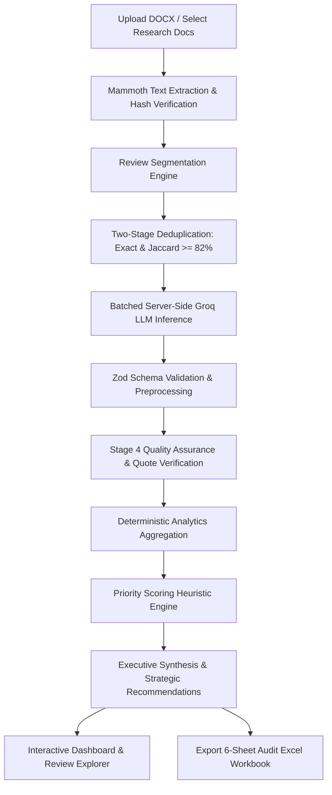

# AI Customer Review Analyzer

> **Turn unstructured customer feedback and DOCX reviews into structured, evidence-backed product intelligence and audit-ready Excel reports.**

[](https://www.typescriptlang.org/)
[](https://react.dev/)
[](https://expressjs.com/)
[](https://tailwindcss.com/)
[](https://groq.com/)
[](https://github.com/exceljs/exceljs)

---

## 1. Overview

Product managers, user researchers, and customer experience teams often grapple with hundreds of qualitative reviews scattered across disparate sources—app stores, third-party review sites, and industry teardown blogs. Manually reading, categorizing, deduplicating, and synthesizing these documents is time-consuming, prone to cognitive bias, and difficult to audit.

**AI Customer Review Analyzer** automates this end-to-end qualitative research workflow:
1. **Ingests DOCX documents** containing raw feedback or editorial reviews.
2. **Deterministically segments** candidate reviews, preserving source context and author metadata.
3. **Applies two-stage deduplication** to detect exact and semantic duplicates across documents, preventing sample inflation.
4. **Executes batched LLM classification** using high-speed, high-reasoning inference (Groq `openai/gpt-oss-120b`) backed by strict **Zod schemas**.
5. **Enforces a Stage 4 Quality Assurance Pass** that verifies verbatim quotation grounding against the original text.
6. **Ranks opportunities** using a transparent prioritization heuristic based on frequency, severity, journey blocker impact, and confidence.
7. **Generates an interactive dashboard** and an **audit-ready, 6-sheet Excel report (`.xlsx`)** with frozen panes, conditional formatting, and traceable source citations.

---

## 2. Key Features

### 📄 Document Ingestion & Text Extraction
- Extracts raw text, headings, and tables from `.docx`, `.txt`, and `.md` files in-memory using `mammoth`.
- Calculates deterministic SHA-256 content hashes to detect duplicate file uploads.
- Enforces a 25 MB file size limit and surfaces partial extraction or parsing warnings.
- Preloads four authentic default research documents for **Read AI** (Trustpilot reviews, Google Play Store reviews, tl;dv blog evaluation, and MeetGeek blog critique).
- Non-destructive replacement: existing documents are retained if a replacement file fails validation.

### 🔍 Deterministic Review Segmentation
- Custom parsing heuristics tailored for consumer review patterns (Trustpilot, Play Store) and long-form editorial teardowns (tl;dv, MeetGeek).
- Differentiates direct first-hand user feedback from editorial commentary, competitor comparisons, and aggregated site summaries.
- Flags ambiguous or boundary-deficient passages for human review (`needs_human_review: true`).

### 🪞 Two-Stage Deduplication Engine
- **Stage 1 (Exact Match)**: Normalizes whitespace, punctuation, and character casing to hash and flag identical reviews copied across multiple documents (e.g., reviews quoted in secondary articles).
- **Stage 2 (Semantic Near-Duplicate Detection)**: Computes token-level Jaccard similarity ($\ge 82\%$) to identify cross-platform syndications or repeated submissions.
- Maintains single-count unique review denominators ($N$) while preserving all source references for full auditability.

### 🧠 Batched AI Inference & Schema Normalization
- Batches candidate reviews to prevent token truncation and minimize round-trip latency.
- Proxies requests securely through a server-side endpoint to Groq's high-reasoning `openai/gpt-oss-120b` (with sub-second inference).
- Classifies each record across:
  - **Sentiment**: `positive`, `negative`, `mixed`, `neutral`, `unclassified`.
  - **Primary & Secondary Themes**: Standardized across a 21-category taxonomy (e.g., *Privacy and consent*, *Meeting participation and auto-join*, *Transcription accuracy*, *Pricing and billing*).
  - **User Journey Stages**: 11 lifecycle phases (e.g., *Signup and onboarding*, *Permissions and integrations*, *During meeting*, *Billing and account management*).
  - **Severity Tiers**: `High`, `Medium`, `Low`, `Unknown`.
  - **Actionable Insights**: Specific user problem statements, product strengths, and concrete engineering recommendations.
- Resilient Zod preprocessing automatically normalizes case variations, converts percentage scores to $[0.0, 1.0]$ floats, and strips markdown code fences.

### 🛡️ Stage 4 Quality Assurance & Grounding
- **Verbatim Excerpt Verification**: Deterministically validates that the LLM's selected `evidence_excerpt` exists as an exact or high-overlap substring in the raw review text.
- **Polarity Sanity Checks**: Identifies severe negative terms (*malware*, *virus*, *spyware*, *unauthorized*, *scam*) to prevent false-positive classifications.
- **Audit Flagging**: Automatically flags ungrounded claims, missing dates, or low-confidence records for human review.

### 📊 Prioritization Scoring Framework
Prioritizes product issues using a transparent heuristic:
$$\text{Priority Score} = 0.40 \cdot \text{Frequency} + 0.30 \cdot \text{Severity} + 0.20 \cdot \text{Journey Impact} + 0.10 \cdot \text{Confidence}$$

- Normalized on a $0\text{--}100$ scale.
- Unscored severity items redistribute weights across available dimensions rather than arbitrarily defaulting to zero.
- Configurable weights via the in-app Settings panel.

### 📑 Multi-Sheet Excel Export (`.xlsx`)
Exports an audit-ready workbook via `exceljs` featuring:
1. **Executive Summary**: High-level metrics, sentiment distribution, top strengths, top opportunities, and methodology.
2. **Review-Level Data**: Granular records with sentiment/severity color highlights, verbatim quotes, and full text.
3. **Theme Analysis**: Aggregated frequency counts, sample shares, positive/negative splits, and average severity.
4. **Product Recommendations**: Ranked issue backlog with problem statements, proposed solutions, and quote citations.
5. **Source Register**: File metadata, hashes, extraction statuses, and candidate counts.
6. **Review Audit**: Complete log of excluded duplicates, ambiguous entries, and user-modified records with audit reasons.
- Auto-filtered headers, frozen top rows, and text-wrapped cells.

---

## 3. How It Works



### End-to-End Workflow:
1. **Ingest**: Documents are loaded via drag-and-drop or selected from default research files. Text and document structure are extracted.
2. **Segment**: The segmentation engine identifies individual review boundaries, reviewer handles, dates, and ratings.
3. **Deduplicate**: Identical reviews appearing across multiple documents are linked; only unique reviews contribute to percentages.
4. **Classify**: Reviews are sent in configurable batches to the backend Groq LLM proxy.
5. **Verify**: Deterministic QA rules verify that every evidence quote is grounded in the source text.
6. **Aggregate & Prioritize**: Frequency counts, sentiment ratios, and priority scores are calculated deterministically in code (not hallucinated by the model).
7. **Report**: Results are rendered across responsive dashboard views and exported to Excel.

---

## 4. Screenshots and Demo

| View | Description | Screenshot Placeholder |
| :--- | :--- | :---: |
| **Dashboard** | High-level metrics, executive synthesis, top strengths, and priority opportunities. | `[ Screenshot: Dashboard Overview ]` |
| **Source Documents** | File management table, extraction status, review counts, and raw text preview drawer. | `[ Screenshot: Documents View & Preview ]` |
| **Analysis Results** | Sentiment distribution cards, journey stage friction bars, and ranked recommendations. | `[ Screenshot: Analysis Results & Metrics ]` |
| **Review Explorer** | Multi-facet filtering, full-text search, and review inspection modal with editing support. | `[ Screenshot: Review Explorer & Detail Modal ]` |
| **Excel Export** | Multi-sheet workbook with frozen panes, conditional formatting, and audit sheets. | `[ Screenshot: Excel Workbook Output ]` |

> *Note: For preview deployments, run the development server locally following the steps below.*

---

## 5. Technology Stack

- **Frontend**: [React 19](https://react.dev/), [TypeScript](https://www.typescriptlang.org/), [Tailwind CSS v4](https://tailwindcss.com/)
- **Icons & UI Utilities**: [Lucide React](https://lucide.dev/), [Motion](https://motion.dev/)
- **Backend**: [Express 4.21](https://expressjs.com/), [Node.js](https://nodejs.org/) (running via `tsx`)
- **Build Tooling**: [Vite 8](https://vitejs.dev/) with Express middleware mounting
- **AI Inference**: [Groq Cloud API](https://groq.com/) running `openai/gpt-oss-120b` (supported alternatives: `openai/gpt-oss-20b`, `qwen/qwen3.8-27b`)
- **Document Processing**: [Mammoth.js](https://github.com/mwilliamson/mammoth.js) (DOCX raw text and HTML extraction)
- **Workbook Generation**: [ExcelJS](https://github.com/exceljs/exceljs) (multi-sheet `.xlsx` generation with styles and frozen panes)
- **Schema Validation**: [Zod](https://zod.dev/) (runtime schema enforcement and input normalization)

---

## 6. Project Architecture

```
ai-customer-review-analyzer/
├── .env.example                 # Environment variables documentation
├── index.html                   # HTML entry point with Plus Jakarta Sans & JetBrains Mono
├── metadata.json                # Application metadata & capabilities configuration
├── package.json                 # Project scripts and dependencies
├── server.ts                    # Full-stack Express server, Groq proxy, & Vite middlewares
├── tsconfig.json                # TypeScript compiler configuration
├── vite.config.ts               # Vite configuration with Tailwind CSS v4 plugin
└── src/
    ├── App.tsx                  # Main application orchestrator & state manager
    ├── index.css                # Global Tailwind CSS stylesheet
    ├── main.tsx                 # React DOM client entry point
    ├── components/
    │   ├── AnalysisProgressModal.tsx # Multi-stage pipeline progress dialog
    │   ├── DashboardView.tsx         # Page A: High-level KPI cards & quick synthesis
    │   ├── DocumentsView.tsx         # Page B: Document management & text preview
    │   ├── Navbar.tsx                # Strict 3-zone top navigation bar
    │   ├── ResultsView.tsx           # Page C: Sentiment, themes, & prioritized opportunities
    │   ├── ReviewExplorerView.tsx    # Page D: Searchable review table & audit modal
    │   └── SettingsView.tsx          # Page E: Model selector, weights, & connection test
    ├── data/
    │   └── defaultDocumentsData.ts   # Bundled authentic Read AI research documents
    ├── types/
    │   ├── index.ts                  # Domain models, enums, and metric interfaces
    │   └── mammoth.d.ts              # Ambient type declarations for Mammoth.js
    └── utils/
        ├── aggregation.ts            # Deterministic metric, theme, & journey aggregation
        ├── deduplication.ts          # Two-stage exact & Jaccard semantic deduplication
        ├── docxExtractor.ts          # Mammoth DOCX extraction & content hashing
        ├── excelExport.ts            # Multi-sheet Excel workbook generator (ExcelJS)
        ├── localClassifier.ts        # Offline rule-based fallback classification engine
        ├── prioritization.ts         # Section 9 scoring heuristic calculation
        ├── qualityCheck.ts           # Stage 4 verbatim quote & polarity QA checks
        └── schema.ts                 # Zod validation schemas & resilient normalizers
```

---

## 7. Getting Started

### Prerequisites
- **Node.js**: v18.0.0 or higher
- **npm** or **bun**
- A **Groq API Key** (obtainable from [Groq Console](https://console.groq.com/))

### Installation Steps

1. **Clone the repository**:
   ```bash
   git clone <repository-url>
   cd ai-customer-review-analyzer
   ```

2. **Install dependencies**:
   ```bash
   npm install
   ```

3. **Configure environment variables**:
   Copy `.env.example` to `.env`:
   ```bash
   cp .env.example .env
   ```
   Add your private Groq API key:
   ```env
   GROQ_API_KEY=gsk_your_actual_key_here
   PORT=3000
   ```

4. **Start the development server**:
   ```bash
   npm run dev
   ```
   The application will start on [http://localhost:3000](http://localhost:3000).

5. **Type checking and verification**:
   ```bash
   # Run TypeScript type check
   npm run lint

   # Build for production
   npm run build
   ```

---

## 8. Environment Variables & Security

| Variable | Required | Description |
| :--- | :---: | :--- |
| `GROQ_API_KEY` | **Yes** | Server-side API key for Groq LLM inference. Kept strictly on the backend. |
| `PORT` | No | Server port (default: `3000`). |
| `APP_URL` | No | Base application URL for hosted environments. |

### 🔒 Security & Privacy Guarantees
- **No Client-Side Secret Leakage**: The Groq API key is defined in `.env` (ignored by `.gitignore`) and accessed exclusively by `server.ts`. Client bundles never receive or package this credential.
- **Data Minimization**: Uploaded document text is processed in-memory and sent only to the configured LLM endpoint for classification.
- **Reviewer PII Protection**: Personal reviewer emails or contact details are redacted by default in exports.
- **Untrusted Input Protection**: Review text is treated strictly as untrusted data in LLM prompts with boundary isolations.

---

## 9. Input & Output Formats

### Supported Inputs
- `.docx` (Microsoft Word documents)
- `.txt` / `.md` (Raw text or markdown feedback exports)
- Recommended file size: $\le 25\text{ MB}$ per file.

### Expected Document Structure
The parser accommodates:
- Structured review cards (Reviewer name, location, date, star rating, and review text).
- Play Store app feedback with developer replies.
- Long-form editorial review articles (e.g., product comparison blog posts).

### Output Artifacts
- **Interactive UI**: Live search, facet filtering, theme aggregation charts, and journey friction breakdowns.
- **Excel Report (`.xlsx`)**:
  - `Executive Summary`: Core metrics, sentiment distribution, and strategic recommendations.
  - `Review-Level Data`: Formatted table with all classified fields, source citations, and color-coded severity.
  - `Theme Analysis`: Theme-by-theme frequency, percentage shares, and positive/negative counts.
  - `Product Recommendations`: Ranked list of product improvements with problem statements and representative quotes.
  - `Source Register`: File audit log with content hashes and extraction warnings.
  - `Review Audit`: Excluded duplicates, low-confidence entries, and user modifications.

---

## 10. Example Use Case: Read AI Review Analysis

An illustrative research assignment analyzing customer feedback for **Read AI** across multiple channels:

1. **Dataset Loaded**:
   - `Read Ai review(Trustpilot).docx` (acute complaints regarding unsolicited bot meeting joins, calendar synchronization, and account deletion difficulties).
   - `Read Ai review(Playstore).docx` (mobile app ratings praising note-taking utility but citing Android login loops and session sign-outs).
   - `Read AI Review(tldv).docx` & `Read AI Review(MeetGeek).docx` (editorial analyses evaluating transcription accuracy, coaching features, and competitor comparisons against tl;dv, MeetGeek, and Fathom).

2. **Extracted Insights**:
   - **Core Strength to Preserve**: High praise for transcription speed, multi-language detection, and structured action items.
   - **Severe Friction Opportunity**: Backlash regarding automated meeting auto-joins and aggressive onboarding invitations, leading to user distrust and IT tenant bans.
   - **Prioritized Recommendation**: Introduce an explicit double opt-in prompt before calendar syncing and provide a one-click bot ejection toggle inside active calls.

---

## 11. Limitations & Future Roadmap

### Current Limitations
- PDF ingestion is currently handled via raw text conversion; direct PDF layout extraction is not yet natively supported.
- OCR text extraction from embedded document images requires pre-processing into text.
- Prioritization scores represent an analytical heuristic rather than a verified statistical probability.

### Future Roadmap
- [ ] Native PDF parsing with multi-column table extraction.
- [ ] Direct review scraping integrations (G2, Capterra, Google Play Developer API).
- [ ] Multi-product comparative side-by-side benchmarking matrices.
- [ ] Embedding-based semantic clustering for emergent theme proposals.
- [ ] Role-based access control (RBAC) and team collaboration workspaces.

---

## 12. Contributing

Contributions are welcome! Please follow this standard workflow:

1. Fork the repository.
2. Create a feature branch:
   ```bash
   git checkout -b feature/your-feature-name
   ```
3. Commit your changes with clear, descriptive commit messages:
   ```bash
   git commit -m "feat: add multi-document comparison matrix"
   ```
4. Verify tests and linting:
   ```bash
   npm run lint && npm run build
   ```
5. Push to your branch and open a Pull Request.

---

## 13. License

This project is licensed under the **Apache License 2.0** as indicated in the source file headers. See individual source files for license details.

---

## 14. Author & Acknowledgments

- **Author**: Built with Google AI Studio.
- Contact / Maintainer: Contact via project repository issues.
